 

 

&nbsp;

---

## About

**Senior Frontend Engineer / Creative Product Engineer** with 14 years of experience building digital products, frontend systems and interactive web experiences.

I work across **frontend architecture, product engineering and creative technology** — from large-scale applications and design systems to motion, WebGL and realtime interaction.

Current focus: **Three.js, WebGL, AI-native interfaces, generative UI and high-performance frontend systems.**

---

## Focus

<table>
<tr>

<td width="33%" valign="top">

### Frontend Systems

React  
TypeScript  
Next.js  
Architecture  
Design Systems  
Performance

</td>

<td width="33%" valign="top">

### Creative Technology

Three.js  
WebGL  
3D Interfaces  
Motion Systems  
Creative Coding  
Interaction Design

</td>

<td width="33%" valign="top">

### Product + AI

AI-native UX  
Generative UI  
Realtime Systems  
LLM Interfaces  
Automation  
Product Engineering

</td>

</tr>
</table>

---

## Technology

  

---

## Case Studies · From the Archive

Production work from 2016 – 2021, recovered, cleaned up and documented — each repo has architecture notes, screenshots and what I would do differently today.

 

<table>
<tr>
<td width="50%" valign="top">

 <b><a href="https://github.com/ycanmurat/otoparcasan-platform">Otoparçasan</a></b> · 2020 – 2021 
Spare-parts marketplace · order-fulfilment state machine · Netsis ERP bridge · DAT VIN search
</td>
<td width="50%" valign="top">

 <b><a href="https://github.com/ycanmurat/otosesli-b2b-portal">Oto Sesli B2B Portal</a></b> · 2020 
93-screen dealer portal · stock, orders, warehouse dispatch, returns, finance dashboards
</td>
</tr>
<tr>
<td width="50%" valign="top">

 <b><a href="https://github.com/ycanmurat/raisavanessa-commerce">Raisa Vanessa</a></b> · 2019 
Luxury fashion e-commerce · bespoke orders · size × colour stock · multi-currency checkout
</td>
<td width="50%" valign="top">

 <b><a href="https://github.com/ycanmurat/lim10-tv">Lim10 TV</a></b> · 2017 – 2018 
Streaming UI · hover previews · customised Plyr player · Laravel production site
</td>
</tr>
</table>

 

| Year | Project | What it shows |
|:---:|---|---|
| 2020 – 21 | [**otoparcasan-platform**](https://github.com/ycanmurat/otoparcasan-platform) | E-commerce + back office, fulfilment pipeline, ERP / payment / e-invoice integrations |
| 2020 | [**otosesli-b2b-portal**](https://github.com/ycanmurat/otosesli-b2b-portal) | Data-dense B2B UI, information architecture for ERP workflows |
| 2019 | [**raisavanessa-commerce**](https://github.com/ycanmurat/raisavanessa-commerce) | Editorial commerce UX, bespoke flow, iyzico 3D Secure + installments |
| 2019 | [**makingknowing-studio**](https://github.com/ycanmurat/makingknowing-studio) | Type-led agency site + CMS, designer store, events portfolio |
| 2019 | [**acilhekim-appointments**](https://github.com/ycanmurat/acilhekim-appointments) | Mobile-first booking flows |
| 2018 | [**hocalarageldik-exam-ui**](https://github.com/ycanmurat/hocalarageldik-exam-ui) | Online exams, optical answer sheet, quizzes for 1M+ students |
| 2017 – 18 | [**lim10-tv**](https://github.com/ycanmurat/lim10-tv) | Streaming front end and video player work |
| 2017 | [**kodakil-cms**](https://github.com/ycanmurat/kodakil-cms) | Multilingual CMS with 30 admin modules, reused across agency sites |
| 2016 | [**kontroldeposu-commerce**](https://github.com/ycanmurat/kontroldeposu-commerce) | Storefront templates bound to CodeIgniter, installment checkout |
| 2016 – 21 | [**kodakil-client-sites**](https://github.com/ycanmurat/kodakil-client-sites) | 13 client sites: corporate, e-commerce, WordPress, Laravel admin, email |

Full case studies on <a href="https://canmurat.com/works">canmurat.com/works</a>

---

## GitHub Activity

  
 

  

 
---

### Creative Engineering · Frontend Architecture · WebGL · AI-native Products

 

I’m interested in systems where **engineering, interaction and visual design behave as one product language**.

  

